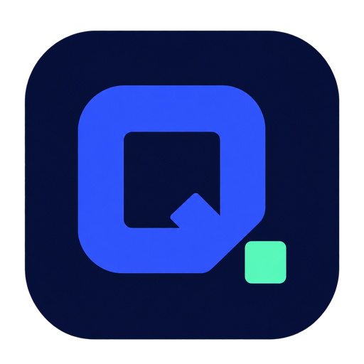
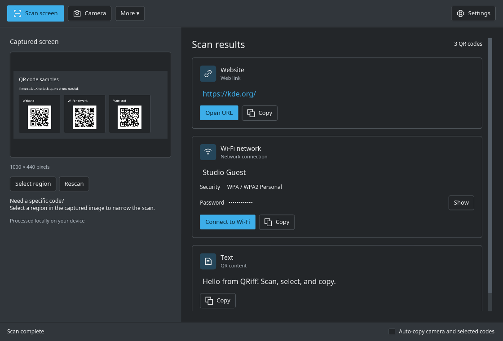
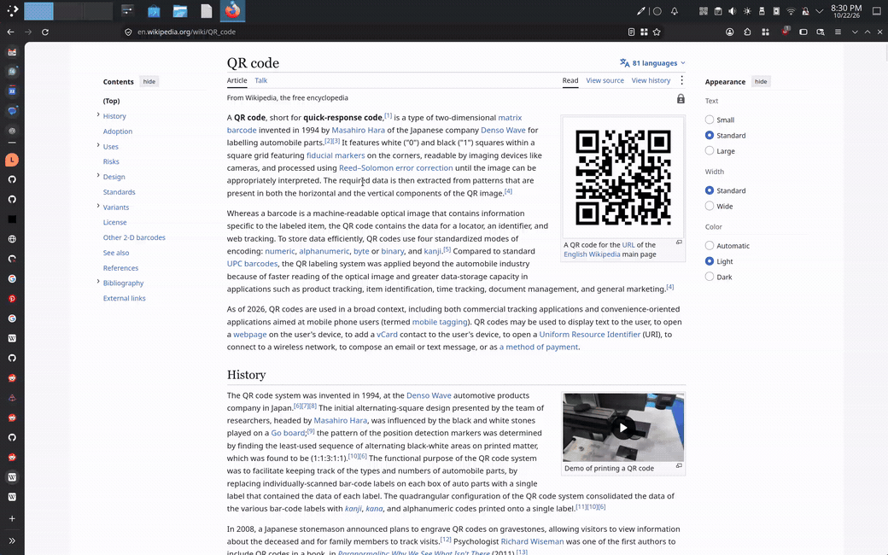
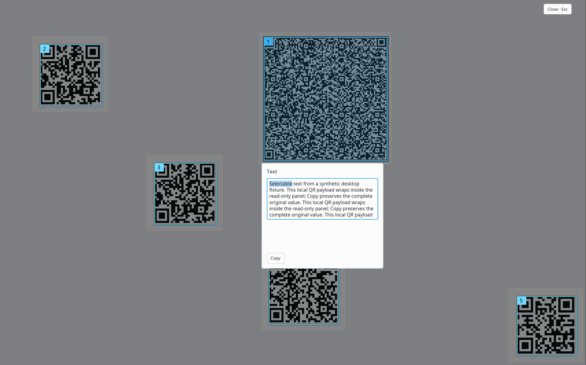
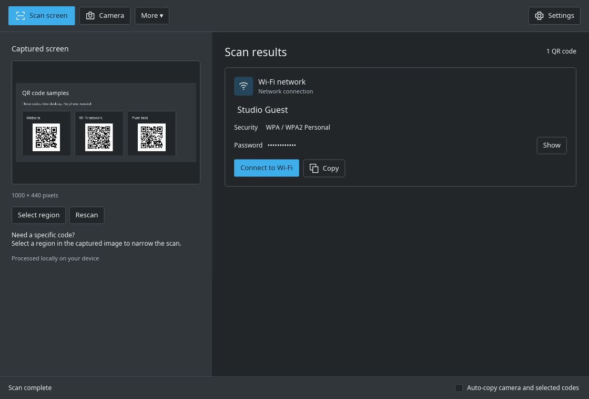

<div align="center">
  
  <h1>QRiff</h1>
  <p><strong>Scan what’s already in front of you.</strong></p>
  <p>A small desktop companion for QR codes on your screen and in the real world.</p>
  <p>
    <a href="#desktop-support"></a>
    <a href="https://iced.rs/"></a>
    <a href="LICENSE"></a>
  </p>
  <p>
    <a href="#get-started"><strong>Get started</strong></a> ·
    <a href="#features">Features</a> ·
    <a href="#see-it-in-action">See it in action</a> ·
    <a href="docs/usage.md">Documentation</a> ·
    <a href="https://github.com/Wattos/qriff/issues">Report a bug</a>
  </p>
  <br />
  
  <p><sub>Scan, read, and act. Native app screenshots use sample QR data.</sub></p>
</div>

Ever spotted a QR code on your desktop and reached for your phone just to
scan it? A link in your browser, a presentation, or a video call shouldn’t
require another device or a screenshot uploaded to a website.

**Finally, a quick and simple way to scan QR codes on your desktop.**
QRiff reads them right where they are. Scan your screen or draw around a code,
then copy its contents, open a link, or join a Wi-Fi network. You can also point
your camera at a printed code.

QRiff lives in your tray, decodes locally, and keeps your latest results close
without filling your desktop with windows.

## Features

- **One code? Already copied.** Scan the screen and a lone QR code goes straight
  to your clipboard, with notification feedback. No selection window to dismiss.
- **Several codes? Pick one.** See numbered highlights over a frozen view of
  your desktop. Click the code you want to read, copy, or act on.
- **Draw, release, scan.** On KDE, Scan region opens Spectacle’s native selector
  with an empty selection. Drag a rectangle around the code and release.
- **Bring your camera.** Scan printed codes with a live preview. Stop scanning
  whenever you’re done; the results stay available for that session.
- **Do something useful.** Open a web link, hand a phone number to your calling
  app, or connect to a supported Wi-Fi network. Actions are always explicit.
- **Copy just the useful bit.** Decoded text is selectable. Grab a substring with
  Ctrl+C, or use Copy for the complete payload.
- **Stay in your flow.** A menu-first tray icon, desktop notifications, and
  **Last scan** keep results accessible. Open the full window when you want it.
- **Keep decoding local.** No account, telemetry, or cloud decoding. QRiff keeps
  scan results in memory instead of building a persistent scan history.

## See it in action

From the tray to your clipboard: scan a single code instantly, or choose among
multiple codes highlighted on your desktop.

<p align="center">
  
</p>


### Pick the right code, right on your desktop

When a screen contains multiple QR codes, QRiff highlights their locations and
dims the background. Select one to reveal its contents and available actions.
Even identical codes at different locations remain individually selectable.

<p align="center">
  
</p>

Use **Tab / Shift+Tab** to move between highlights and controls, and **Enter**
to select. **Escape** clears the selected panel, then dismisses the overlay.
A screen with one code skips this step and copies it immediately.

### From a code to a useful action

QRiff recognizes web links, explicit telephone links, and supported Wi-Fi
payloads. Wi-Fi passwords stay hidden until you reveal them; scanning a code
never opens a browser, starts a call, or changes your network by itself.

<p align="center">
  
</p>

<details>
<summary><strong>What can I scan and do?</strong></summary>

| QR content | Available actions |
| --- | --- |
| Web link | Copy or open a validated HTTP/HTTPS URL |
| Telephone link | Copy or open a configured calling app for a valid `tel:` link |
| Wi-Fi network | Copy or connect through NetworkManager for supported security types |
| Plain text | Read, select a substring, or copy everything |
| Binary payload | View and copy a labeled hexadecimal representation |

Unsupported or malformed content remains readable/copyable where appropriate;
it does not gain an unsafe action. Wi-Fi support includes open networks,
WPA/WPA2 Personal, and WPA3 where the system supports it. Enterprise/EAP and WEP
connections are not supported.

[Action details and requirements →](docs/usage.md#interface-and-result-actions)

</details>

## Get started

Linux x86_64 bundles are built by [GitHub Actions](https://github.com/Wattos/qriff/actions/workflows/linux-release.yml).
Published versions are available on the [Releases page](https://github.com/Wattos/qriff/releases):
choose **AppImage** for a single-file app, or **tar.gz** for an extracted bundle.
Draft releases remain private until published.

[Install a Linux release bundle →](docs/wiki/Installation.md)

To build from source, use stable Rust and the native dependencies below.

[Install the prerequisites →](docs/usage.md#build-and-run)

```sh
git clone https://github.com/Wattos/qriff.git
cd qriff
cargo run --release -- --background
```

Then open the tray menu:

| Choose | What happens |
| --- | --- |
| **Scan screen** | One code copies immediately; multiple codes open the chooser |
| **Scan region** | Draw a fresh rectangle using the desktop’s supported region selector |
| **Scan camera** | Open the camera preview and scan printed codes |
| **Last scan** | Revisit the latest results and their actions |
| **Open window** | Open the full scanner interface |

Run `cargo run --release` to start with the main window instead. Its **Scan
screen** button keeps the captured image and results in the window; the tray
menu uses the windowless copy-or-choose flow. For a launcher,
icons, and the `qriff` command in your application menu, follow the
[installation guide](docs/usage.md#build-and-run).

> **Clipboard support:** tray and overlay copying use `wl-copy` from
> **wl-clipboard** and require compatible Wayland clipboard support. If copying
> fails, QRiff reports it and keeps the result in Last scan.

## Desktop support

QRiff is **Linux-first and designed for Wayland**. KDE Plasma is the primary
development target; this is not yet a promise of identical behavior everywhere.

| Desktop | Current status |
| --- | --- |
| **KDE Plasma / Wayland** | Primary tested target. Native region selection uses Spectacle. |
| **GNOME / Wayland** | Portal-dependent; not yet manually validated. A tray extension is needed for the tray experience. |
| **Hyprland / Sway** | Portal and panel support required; not yet manually validated. |
| **Windows / macOS** | Not supported by the current build. |

The multi-code desktop overlay currently requires **one supported, unchanged
display**. Other layouts fall back to notifications and Last scan instead of
placing highlights at guessed coordinates. Single-code screen scans do not need
overlay geometry.

Screenshot permissions are controlled by your desktop. KDE region scanning needs
**Spectacle**; other desktops need a screenshot portal that supports direct area
selection. Camera access requires permission to use the device. Wi-Fi actions
require NetworkManager and the appropriate system permissions.

[Desktop setup and behavior →](docs/usage.md) ·
[Verification, screenshots, and known gaps →](docs/verification.md#tray-overlay-verification-2026-10-22)

## Your codes stay yours

QRiff decodes screenshots and camera frames on your device. It does not upload
them for scanning, collect telemetry, or save a persistent QR history. **Last
scan** is temporary, in-memory state. Only app preferences are persisted;
capture providers can create temporary image files during a scan.

You control external actions. Opening a URL hands it to your browser; Call uses
your configured handler; Connect to Wi-Fi requests the selected network through
NetworkManager.

For text QR codes, Copy preserves the **complete original payload**, including
credentials inside a Wi-Fi QR code. Binary payloads copy as labeled hexadecimal. Wi-Fi passwords are masked in the interface and omitted from
notification labels; other decoded text can appear in notifications.

## Help shape QRiff

Found a code that won’t scan, a desktop integration problem, or a rough edge?
[Open an issue](https://github.com/Wattos/qriff/issues/new) with your desktop,
Wayland session, steps to reproduce, and what you expected. Share a non-sensitive
sample code when possible; remove Wi-Fi passwords and other private content.

Code contributions are welcome. QRiff is built with **Rust and Iced**, with a
software renderer by default. Start with the [usage and development guide](docs/usage.md)
and [verification notes](docs/verification.md).

## License

[MIT](LICENSE) © 2026 Filip Wieladek. Dependencies retain their own licenses.
